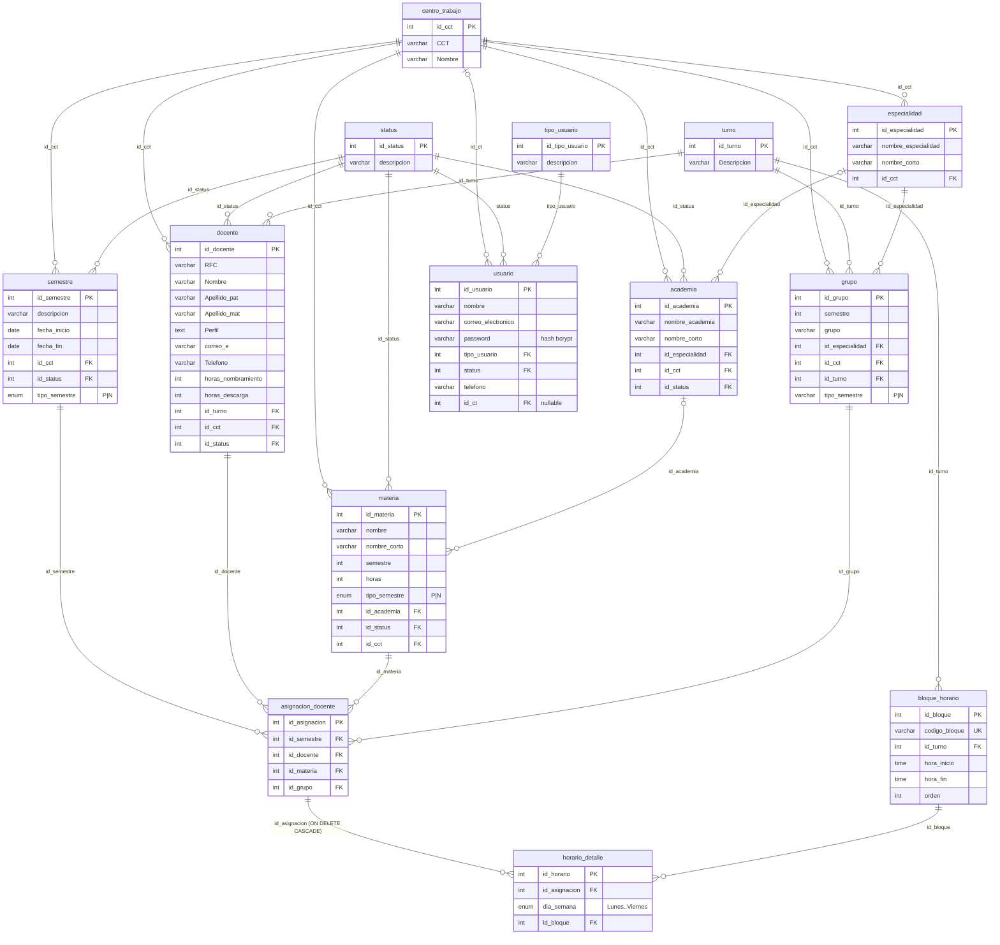

# Manual Técnico Completo – sis_doc (Servicios Docentes, CETIS 155)

Documento generado a partir de `sis_doc bd.sql`, `database/seed.sql`, `src/**` y `public/**`.

> **Nota de alcance.** El proyecto real **no** contiene `src/controllers/`, `src/middlewares/`, `src/helpers/`, plantillas `.hbs` ni Handlebars. La lógica de controlador vive dentro de `src/routes/api.ts`, los middlewares en `src/lib/auth.ts`, las validaciones de negocio en `src/lib/validation.ts` y la interfaz es una SPA en HTML/JS vanilla servida desde `public/`. Este manual documenta lo que existe y señala la equivalencia con cada capa solicitada.

---

## 1. Diagrama Entidad-Relación y Modelo de Datos (SQL)

Motor: MariaDB 10.4 / MySQL, InnoDB, `utf8mb4_general_ci`, base de datos `sis_doc`.

### 1.1 Diagrama ER



### 1.2 Tablas, claves y cardinalidad

| Tabla | PK | Claves foráneas | Cardinalidad principal |
|---|---|---|---|
| `centro_trabajo` | `id_cct` | – | 1 CCT → N docentes, materias, grupos, semestres, especialidades, academias, usuarios |
| `status` | `id_status` | – | 1 status → N en docente/materia/semestre/academia/usuario (1 Activo, 2 Inactivo, 3 Suspendido, 4 Pendiente, 5 Baja) |
| `tipo_usuario` | `id_tipo_usuario` | – | 1 tipo → N usuarios |
| `turno` | `id_turno` | – | 1 Matutino, 2 Vespertino, 3 Mixto; 1 turno → N docentes, grupos, bloques |
| `usuario` | `id_usuario` | `tipo_usuario`, `status`, `id_ct` | N:1 con tipo, status y CCT (`id_ct` nulo = sin CCT) |
| `especialidad` | `id_especialidad` | `id_cct` | 1 especialidad → N grupos y N academias |
| `academia` | `id_academia` | `id_especialidad`, `id_cct`, `id_status` | 1 academia → N materias |
| `docente` | `id_docente` | `id_turno`, `id_cct`, `id_status` | 1 docente → N asignaciones |
| `materia` | `id_materia` | `id_academia`, `id_status`, `id_cct` | 1 materia → N asignaciones |
| `grupo` | `id_grupo` | `id_especialidad`, `id_cct`, `id_turno` | 1 grupo → N asignaciones |
| `semestre` | `id_semestre` | `id_cct`, `id_status` | 1 semestre → N asignaciones |
| `asignacion_docente` | `id_asignacion` | `id_semestre`, `id_docente`, `id_materia`, `id_grupo` | Resuelve la relación N:M docente–materia–grupo por semestre; 1 asignación → N celdas de horario |
| `bloque_horario` | `id_bloque` | `id_turno` | 1 bloque → N celdas de horario |
| `horario_detalle` | `id_horario` | `id_asignacion`, `id_bloque` | Cada fila ocupa un (día, bloque) de una asignación |

Bloques horarios sembrados: Matutino `M1–M8` (07:00–14:00, receso antes de `M4`) y Vespertino `V1–V8` (14:00–21:00, receso antes de `V4`).

### 1.3 Restricciones

**`ON DELETE CASCADE`** — única en todo el esquema:

- `horario_detalle.id_asignacion → asignacion_docente.id_asignacion`: al borrar una asignación se eliminan todas sus celdas de horario.

El resto de FKs usan el comportamiento por defecto (`RESTRICT`/`NO ACTION`), por lo que no se puede borrar un padre con hijos. Por eso la API usa **borrado lógico** (`id_status = 5`, "Baja") para `docente`, `materia`, `academia` y `usuario`, y para `semestre` establece `id_status = 2` (Inactivo).

**Claves `UNIQUE`:**

| Tabla | Índice | Columnas | Regla que garantiza |
|---|---|---|---|
| `asignacion_docente` | `uk_asignacion_docente` | `(id_semestre, id_docente, id_materia, id_grupo)` | No duplicar una asignación en el mismo semestre |
| `horario_detalle` | `uk_asignacion_dia_bloque` | `(id_asignacion, dia_semana, id_bloque)` | Una asignación no ocupa dos veces la misma celda |
| `bloque_horario` | `codigo_bloque` | `codigo_bloque` | Código de bloque único (M1…V8) |

Otras restricciones: `semestre.tipo_semestre` y `materia.tipo_semestre` son `ENUM('P','N')`; `horario_detalle.dia_semana` es `ENUM('Lunes','Martes','Miercoles','Jueves','Viernes')` (sin acento; la API traduce `Miércoles` ↔ `Miercoles`).

**Procedimiento almacenado:** `sp_insertar_grupo(p_semestre, p_grupo, p_id_especialidad, p_id_cct, p_id_turno)` valida existencia de especialidad, CCT y turno (`SIGNAL SQLSTATE '45000'`) y calcula `tipo_semestre` (`'P'` si el semestre es par, `'N'` si es impar). La API actual inserta directamente en `grupo` y recibe `tipo_semestre` desde el cliente (validado a `P`/`N`).

**Discrepancia de roles:** el dump `sis_doc bd.sql` trae `tipo_usuario` = 1 Super Administrador, 2 Administrador, 3 Revisor, 4 Docente. `database/seed.sql` redefine 3 = `Captura` y agrega 5 = `Revisor`, que es lo que espera el código (`ROLES` en `src/lib/auth.ts`). Debe aplicarse el seed sobre el dump.

### 1.4 Vistas SQL de lectura

| Vista | Tablas que une | Columnas clave expuestas | Uso en la API |
|---|---|---|---|
| `vista_docente` | `docente` ⟕ `turno`, `centro_trabajo`, `status` | `nombre_completo` (`Apellido_pat Apellido_mat Nombre`), `turno`, `centro_trabajo`, `status` | `GET /docentes`, catálogos |
| `vista_materias` | `materia` ⟕ `academia`, `status` | `nombre_materia`, `nombre_academia`, `academia_corto`, `status_materia`, `id_cct` | `GET /materias`, catálogos |
| `vista_grupos` | `grupo` ⟕ `especialidad`, `centro_trabajo`, `turno` (ORDER BY `grupo`) | `especialidad_corta`, `CCT`, `centro_trabajo`, `turno` | `GET /grupos`, catálogos |
| `vista_semestre` | `semestre` ⨝ `centro_trabajo`, `status` | `descripcion_semestre`, `CCT`, `nombre_centro_trabajo`, `descripcion_status` | `GET /semestres`, resolución de semestre activo |
| `vista_academias` | `academia` ⟕ `centro_trabajo`, `status`, `especialidad` | `centro_trabajo`, `status_academia`, `nombre_especialidad` | CRUD `/academias`, catálogos |
| `vista_asignacion_docente` | `asignacion_docente` ⨝ `semestre`, `vista_docente`, `materia` ⟕ `grupo` | `nombre_docente`, `nombre_materia`, `horas_materia`, `grupo` (`"<semestre>° <grupo>"`) | `GET /asignaciones` |

`horario_detalle` no tiene vista; `HORARIO_SELECT` en `api.ts` hace el JOIN con `asignacion_docente`, `docente`, `materia`, `grupo` y `bloque_horario`.

---

## 2. Arquitectura del Código Fuente (TypeScript y frontend)

Stack: Node.js (ESM) + Express 4 + `express-session` + `mysql2/promise` + `bcryptjs`; TypeScript 5 ejecutado con `tsx`; frontend HTML/CSS/JS sin framework ni motor de plantillas. Scripts: `npm run dev` (`tsx watch src/server.ts`), `npm run build` (`tsc`), `npm start`, `npm test`.

### 2.1 Estructura de carpetas

```text
sistema/
├── PLAN_DESARROLLO_COPILOT.md      Reglas de negocio de referencia
├── package.json / tsconfig.json
├── sis_doc bd.sql                  Dump completo (esquema, datos, vistas, SP)
├── database/
│   ├── schema.sql                  Esquema reproducible de la app
│   └── seed.sql                    Catálogos base y roles (incluye Revisor = 5)
├── docs/
│   └── MANUAL_TECNICO_COMPLETO.md  Este documento
├── src/
│   ├── server.ts                   Arranque Express: sesión, montaje de routers y middlewares, estáticos
│   ├── routes/                     Capa de rutas + lógica de controlador
│   │   ├── auth.ts                 /api/auth/login | logout | me
│   │   └── api.ts                  Resto de la API REST (catálogos, carga docente, horarios)
│   ├── lib/                        Equivalente a middlewares + helpers + servicios
│   │   ├── auth.ts                 authMiddleware, roleMiddleware, cctMiddleware, ROLES
│   │   ├── db.ts                   Pool mysql2, query(), withTransaction()
│   │   ├── validation.ts           Reglas de negocio puras (horas, tipo de semestre, empalmes)
│   │   └── demo-data.ts            Datos de demostración
│   └── types/express-session.d.ts  Tipado de req.session (user, activeSemesterId)
├── public/                         Frontend estático (reemplaza views/*.hbs)
│   ├── login.html + login.js       Pantalla de acceso
│   ├── index.html + app.js         SPA: Carga docente, Horarios, Catálogos
│   └── styles.css
├── tests/                          validation, schema, auth, api-catalogs (node:test vía tsx)
└── scripts/                        (vacío)
```

| Capa solicitada | Equivalente real |
|---|---|
| `src/controllers` | Handlers inline en `src/routes/api.ts` y `src/routes/auth.ts` |
| `src/routes` | `src/routes/*.ts` (`buildApiRouter`, `buildAuthRouter`) |
| `src/middlewares` | `src/lib/auth.ts` |
| `src/helpers` | `src/lib/validation.ts`, `src/lib/db.ts` y helpers privados de `api.ts` |
| `views/` / `.hbs` | `public/*.html` + render por JavaScript en `public/app.js` |

### 2.2 Montaje de la aplicación (`src/server.ts`)

```ts
app.use(express.json());
app.use(session({ rolling: true, resave: false, saveUninitialized: false,
                  cookie: { secure: false, maxAge: 5 * 60 * 1000 } }));
app.use('/api/auth', buildAuthRouter());                       // público
app.use('/api', authMiddleware, roleMiddleware, cctMiddleware, buildApiRouter());
app.use(express.static(publicDir));
app.get('*', → public/index.html);
```

El orden es relevante: autenticación → autorización por rol → restricción por CCT → ruta. Variables de entorno: `PORT`, `SESSION_SECRET`, `DB_HOST`, `DB_PORT`, `DB_USER`, `DB_PASSWORD`, `DB_NAME`.

### 2.3 Catálogo de endpoints REST

Todos bajo `/api`. Las respuestas de error usan `{ message, code?, errors? }`. Los permisos se detallan en §2.4.

#### Autenticación (`routes/auth.ts`, sin middlewares)

| Método | Ruta | Entrada | Lógica |
|---|---|---|---|
| POST | `/auth/login` | body `correo_electronico`, `password` | Busca el usuario (JOIN `tipo_usuario`, `centro_trabajo`); exige `status = 1`; `bcrypt.compare`; `session.regenerate()` (anti fijación de sesión); guarda `session.user` y devuelve `{ user }`. 400 sin datos, 401 credenciales inválidas/usuario inactivo |
| POST | `/auth/logout` | – | `session.destroy()`, limpia cookie `connect.sid`, 204 |
| GET | `/auth/me` | – | Devuelve `{ user }` o 401 `UNAUTHENTICATED` |

#### Sistema y semestre activo

| Método | Ruta | Entrada | Lógica |
|---|---|---|---|
| GET | `/health` | – | Público. `SELECT 1`; `{ ok, database }` |
| GET | `/semestres` | `id_cct` (inyectado) | Lista `vista_semestre` ordenada por `fecha_inicio DESC` |
| GET | `/semestres/:id` | `id` | Detalle; 404 si no existe |
| POST | `/semestres` | `descripcion`, `id_cct`, `tipo_semestre` (P/N), `fecha_inicio`, `fecha_fin`, `id_status` | Si `id_status = 1` desactiva el resto de semestres activos; inserta |
| PUT | `/semestres/:id` | igual que POST | Actualiza; si queda activo, desactiva los demás |
| DELETE | `/semestres/:id` | `id` | Borrado lógico: `id_status = 2` |
| GET | `/session/semestre` | – | Devuelve el semestre activo guardado en sesión |
| POST | `/session/semestre` | `semesterId` | Marca ese semestre como activo (`id_status = 1`, el resto `2`) y lo guarda en `session.activeSemesterId` |

**Resolución del semestre** (`resolveRequestSemester`): `?semesterId` → `body.id_semestre` → `session.activeSemesterId` → semestre con `id_status = 1` más reciente → el más reciente. Siempre acotado al CCT efectivo.

#### Catálogos genéricos (`registerCatalogCrudRoutes`)

Cada catálogo expone `GET /x`, `GET /x/:id`, `POST /x`, `PUT /x/:id`, `DELETE /x/:id`. Los SQL usan parámetros `?` (sin concatenar valores del usuario). Con `cctColumn` configurado, PUT/DELETE vuelven a leer el registro y responden 403 `FORBIDDEN_CCT` si pertenece a otro CCT.

| Ruta base | Tabla | Campos | Validación | DELETE |
|---|---|---|---|---|
| `/centros-trabajo` | `centro_trabajo` | `CCT`, `Nombre` | CCT ≤ 10, Nombre ≤ 100 | físico |
| `/academias` | `academia` | `nombre_academia`, `nombre_corto`, `id_especialidad`, `id_cct`, `id_status` | ≤ 100 / ≤ 10 | lógico (`id_status = 5`) |
| `/especialidades` | `especialidad` | `nombre_especialidad`, `nombre_corto`, `id_cct` | ≤ 100 / ≤ 20 | físico |
| `/status` | `status` | `descripcion` | ≤ 100 | físico |
| `/tipos-usuario` | `tipo_usuario` | `descripcion` | ≤ 200 | físico |
| `/usuarios` | `usuario` | ver abajo | ver abajo | lógico (`status = 5`) |

**Usuarios:** `nombre` (≤ 200), `correo_electronico` (formato y ≤ 100), `tipo_usuario`, `status`, `telefono` (≤ 20), `id_ct`, `password` (8–72 caracteres; obligatorio al crear, opcional al editar). La contraseña se almacena con `bcrypt` (12 rondas); nunca se devuelve en las consultas.

#### Turnos y bloques

| Método | Ruta | Lógica |
|---|---|---|
| GET/POST/PUT/DELETE | `/turnos`, `/turnos/:id` | CRUD sobre `turno.Descripcion`; DELETE físico (409 si hay dependencias) |
| GET/POST/PUT/DELETE | `/bloques`, `/bloques/:id` | CRUD de `bloque_horario` (`codigo_bloque`, `id_turno`, `hora_inicio`, `hora_fin`, `orden`); 409 si hay horarios que lo usan |

#### Docentes

| Método | Ruta | Entrada | Lógica |
|---|---|---|---|
| GET | `/docentes` | – | `vista_docente` filtrada por CCT, ordenada por apellidos |
| GET | `/docentes/:id` | `id` | Detalle; 403 si es de otro CCT |
| POST | `/docentes` | `RFC`, `Nombre`, `Apellido_pat`, `Apellido_mat`, `Perfil`, `correo_e`, `Telefono`, `horas_nombramiento`, `horas_descarga`, `id_turno`, `id_cct`, `id_status` | `validateDocenteHours`: nombramiento 0–40, descarga 0–10, descarga ≤ nombramiento |
| PUT | `/docentes/:id` | igual | Verifica CCT del registro existente y valida horas |
| DELETE | `/docentes/:id` | `id` | Borrado lógico `id_status = 5` |
| GET | `/docentes/:id/horas-disponibles` | `?semesterId` | `horas_disponibles = nombramiento − descarga`; `horas_asignadas = SUM(materia.horas)` del semestre; `horas_restantes` |

#### Materias y grupos

| Método | Ruta | Entrada | Lógica |
|---|---|---|---|
| GET | `/materias` | `?semesterId`, `?grupoId`, `?all=1` | Sin `all`: solo materias con `tipo_semestre` y CCT del semestre; con `grupoId` exige que el grupo tenga el mismo `semestre`, tipo y CCT. Con `all=1`: todo el catálogo del CCT |
| GET | `/materias/:id` | `id` | Detalle con control de CCT |
| POST/PUT | `/materias[/:id]` | `nombre`, `nombre_corto`, `semestre`, `horas`, `tipo_semestre` (P/N), `id_academia`, `id_status`, `id_cct` | PUT valida CCT existente |
| DELETE | `/materias/:id` | `id` | Lógico `id_status = 5` |
| GET | `/grupos` | `?semesterId`, `?materiaId`, `?all=1` | Simétrico a materias |
| GET | `/grupos/:id` | `id` | Detalle con control de CCT |
| POST/PUT | `/grupos[/:id]` | `grupo`, `semestre`, `id_especialidad`, `id_cct`, `id_turno`, `tipo_semestre` | Valida P/N y CCT |
| DELETE | `/grupos/:id` | `id` | Físico; 409 si tiene asignaciones |

#### Carga docente (`asignacion_docente`)

| Método | Ruta | Entrada | Lógica |
|---|---|---|---|
| GET | `/asignaciones` | `semesterId`, `docenteId` y/o `grupoId` (al menos uno) | Consulta `vista_asignacion_docente` del semestre |
| GET | `/asignaciones/:id` | `id` | Detalle |
| POST | `/asignaciones` | `id_docente`, `id_materia`, `id_grupo` (+ semestre) | `persistAsignacion`: transacción con `SELECT … FOR UPDATE` sobre docente, semestre, materia y grupo; detecta duplicado y suma horas ya asignadas; ejecuta `validateAsignacionDocente`; INSERT. 201 `{ id }`, 400 reglas, 409 duplicado |
| PUT | `/asignaciones/:id` | igual | Misma validación excluyendo la propia asignación |
| DELETE | `/asignaciones/:id` | `id` | Solo si el semestre está activo (403 si no) y pertenece al semestre seleccionado (409); borra y las celdas de horario caen por `CASCADE` |

`validateAsignacionDocente` exige: semestre activo (`id_status = 1`); `tipo_semestre` de materia y grupo igual al del semestre; mismo número de semestre en materia y grupo; mismo CCT en semestre, docente, materia y grupo; sin duplicado; y `horasAsignadas + materia.horas ≤ nombramiento − descarga`.

#### Horario (`horario_detalle`)

| Método | Ruta | Entrada | Lógica |
|---|---|---|---|
| GET | `/catalogos` | `?semesterId`, `?grupoId`, `?materiaId` | Paquete único para la SPA: `activeSemester, semestres, turnos, bloques, docentes, materias, grupos, centrosTrabajo, especialidades, academias, statuses, tiposUsuario, horario` |
| GET | `/horario` | `?semesterId` | Celdas del semestre (`HORARIO_SELECT`) |
| GET | `/horario/grid` | `semesterId`, `docenteId` y/o `grupoId` | Devuelve `{ activeSemester, dias, bloques, celdas }`; con grupo filtra bloques por el turno del grupo |
| GET | `/horario/:id` | `id` | Celda individual |
| POST | `/horario/validar` | `id_asignacion`, `dia_semana`, `id_bloque`, `id_horario?` | Ejecuta las validaciones sin escribir; devuelve `{ validation: { valid, errors } }` |
| POST | `/horario` | `id_asignacion`, `dia_semana`, `id_bloque` | Alterna celda: si está libre y válida hace INSERT (201); si ya la ocupa la misma asignación la elimina (200 `removed: true`); si la ocupa otra responde 409 `Horario no disponible.` |
| PUT | `/horario/:id` | igual | Mueve una celda tras revalidar |
| DELETE | `/horario/:id` | `id` | Elimina la celda (semestre debe estar activo) |

`validateHorarioAssignment` aplica: día hábil válido; semestre activo; asignación existente y del semestre; coherencia P/N; mismo número de semestre; mismo CCT; **bloque del mismo turno que el grupo**; la materia no puede superar sus `horas` semanales en bloques; el docente no puede superar sus horas disponibles; **sin empalme de docente** (mismo día y bloque) y **sin empalme de grupo**. Todo se ejecuta en `withTransaction` con bloqueos `FOR UPDATE` para evitar condiciones de carrera; `ER_DUP_ENTRY` se traduce a 409.

### 2.4 Middlewares de seguridad (`src/lib/auth.ts`)

#### `authMiddleware` — autenticación e inactividad de 5 minutos

- Deja pasar solo `/health` (`PUBLIC_PATHS`).
- Si no existe `req.session.user` responde `401 { code: 'UNAUTHENTICATED' }`.
- **Inactividad de 5 min:** se implementa en `server.ts` con `cookie.maxAge = 300000 ms` y `rolling: true`. Cada petición válida renueva la cookie y la sesión; tras 5 minutos sin actividad `express-session` descarta la sesión, y el siguiente request llega sin `session.user` → 401. El frontend (`requestJson`) detecta el 401 y redirige a `/login.html`.
- Nota operativa: no hay `store` configurado, por lo que se usa `MemoryStore` (adecuado solo para desarrollo) y `cookie.secure = false`; en producción con HTTPS debe cambiarse.

#### `roleMiddleware` — permisos por rol

Matriz por prefijo de ruta (`ROUTE_PERMISSIONS`); `GET`/`HEAD` usan `read`, cualquier otro método usa `write`. Una ruta sin entrada en la matriz queda denegada. Responde `403 { code: 'FORBIDDEN' }`.

| Rol (`ROLES`) | id |
|---|---|
| SUPERADMIN | 1 |
| ADMIN | 2 |
| CAPTURA | 3 |
| DOCENTE | 4 |
| REVISOR | 5 |

| Prefijo | Lectura | Escritura |
|---|---|---|
| `/usuarios`, `/tipos-usuario`, `/status` | Superadmin | Superadmin |
| `/semestres`, `/centros-trabajo`, `/bloques`, `/turnos` | Superadmin, Admin, Revisor | Superadmin |
| `/docentes`, `/materias`, `/grupos`, `/academias`, `/especialidades`, `/asignaciones`, `/horario`, `/session` | Superadmin, Admin, Revisor | Superadmin, Admin |
| `/catalogos` | Superadmin, Admin, Revisor | nadie |

Captura (3) y Docente (4) no tienen permisos en ninguna ruta de la API.

#### `cctMiddleware` — restricción estricta por CCT (`id_ct`)

Aplica solo a **Administrador** y **Revisor** (`CCT_RESTRICTED_ROLES`); Superadministrador no se restringe.

1. Si `session.user.id_ct` es nulo → `403 FORBIDDEN_CCT` ("sin centro de trabajo asignado").
2. Si el cliente envía `id_cct` en `body` o `query` y es distinto de `user.id_ct` → `403 FORBIDDEN_CCT`.
3. Sobrescribe `req.body.id_cct` y `req.query.id_cct` con `user.id_ct`, de modo que las rutas aplican el filtro de forma transparente (`getRequestCct`).
4. En las rutas, `cctMismatch()` revalida el CCT de registros ya existentes antes de leer, editar o eliminar (docentes, materias, grupos, catálogos con `cctColumn`, `horas-disponibles`).

`getEffectiveCct(req)` expone el mismo criterio para reutilización (devuelve `null` para Superadmin).

### 2.5 Helpers y vistas (equivalente a `.hbs`)

**No hay Handlebars:** no existen `registerHelper`, plantillas `.hbs` ni partials. Se documenta el equivalente funcional.

#### Helpers de backend

| Archivo | Helper | Función |
|---|---|---|
| `lib/db.ts` | `pool`, `query(sql, params)` | Pool `mysql2` (10 conexiones) con consultas parametrizadas |
| `lib/db.ts` | `withTransaction(fn)` | BEGIN/COMMIT, ROLLBACK ante error, libera conexión |
| `lib/validation.ts` | `getAvailableHours`, `validateDocenteHours`, `validateAsignacionDocente`, `validateHorarioAssignment`, `getScheduleCellAction`, `normalizeSemesterType` | Reglas de negocio puras y testeables (`tests/validation.test.ts`) |
| `routes/api.ts` | `getRequestCct`, `cctMismatch`, `getSemesterById`, `resolveRequestSemester`, `buildMateriaListFilter`, `buildGrupoListFilter`, `registerCatalogCrudRoutes`, `registerReadOnlyCatalogRoutes`, `persistAsignacion`, `validateScheduleSlot`, `respondScheduleError` | Utilidades internas de la capa de rutas |

#### Páginas y "plantillas"

| Archivo | Papel |
|---|---|
| `public/login.html` + `login.js` | Formulario `#login-form`; `POST /api/auth/login`; si ya hay sesión (`GET /api/auth/me`) redirige a `/` |
| `public/index.html` | Estructura de la SPA: cabecera con selector de periodo y usuario, navegación por pestañas y tres vistas |
| `public/app.js` | Estado (`state`), render por template strings, eventos y llamadas a la API |
| `public/styles.css` | Estilos |

Vistas de `index.html` (equivalentes a partials por pantalla):

| Vista | Contenedor | Contenido |
|---|---|---|
| Carga docente | `#view-load` | `#teacher-select`, resumen de horas, `#assignment-form` (materia, grupo, especialidad, turno), tabla `#assignment-table-body` |
| Horarios | `#view-schedule` | Modos grupo / docente / materias por semestre, `#schedule-assignment-select`, retícula `#schedule-grid` |
| Catálogos | `#view-catalogs` | Selector de catálogo, buscador, tabla paginada `#catalog-table`, acciones Nuevo/Editar/Eliminar/CSV/Imprimir, diálogo `#catalog-dialog` |

Los "helpers" de render en `app.js` cumplen el papel de helpers/partials de Handlebars: `escapeHtml` (previene XSS en todo texto insertado), `optionMarkup`/`fillSelect` (selects), `renderScheduleGrid` (tabla de horario con filas de receso), `renderCatalogTable`, `renderCatalogEditor` (formulario dinámico desde `catalogDefinitions`), `showMessage` (mensajes con auto-ocultado de 5.2 s).

#### Control de acceso en el cliente

`getCatalogAccess(key)` devuelve `full`, `readonly` o `none` según el rol y `isGlobalReadOnly()` bloquea escrituras para Revisor/Captura/Docente. Es solo una mejora de UX: la autoridad real son `roleMiddleware` y `cctMiddleware`.

#### Conexión con el backend vía Fetch API

Toda llamada pasa por `requestJson(url, options)` (`credentials: 'same-origin'`, `Content-Type: application/json`, manejo de 204, 401 → redirección a login y mensajes de `body.message` + `body.errors`).

| Acción de la interfaz | Llamada |
|---|---|
| Arranque (`bootstrap`) | `GET /api/auth/me` → `GET /api/semestres` + `GET /api/session/semestre` → `GET /api/catalogos?semesterId=` |
| Cambiar periodo | `GET /api/catalogos?semesterId=` |
| Elegir docente | `GET /api/asignaciones?semesterId=&docenteId=` y `GET /api/docentes/:id/horas-disponibles?semesterId=` |
| Agregar asignación | `POST /api/asignaciones` |
| Cambiar grupo/docente en Horarios | `GET /api/asignaciones?...` y `GET /api/horario/grid?...` |
| Clic en celda de la retícula | `POST /api/horario` |
| Catálogos | `GET/POST/PUT/DELETE` sobre `endpoint` de `catalogDefinitions` (`/api/docentes`, `/api/materias?all=1`, `/api/grupos?all=1`, `/api/semestres`, `/api/academias`, `/api/centros-trabajo`, `/api/especialidades`, `/api/turnos`, `/api/bloques`, `/api/status`, `/api/tipos-usuario`, `/api/usuarios`) |
| Cerrar sesión | `POST /api/auth/logout` |

---

## 3. Flujo de Ejecución End-to-End

**Caso:** un Administrador del CCT 1 asigna el bloque `M2` del lunes a una asignación docente en la vista **Horarios** (clic en una celda libre `+`).

```mermaid
sequenceDiagram
    autonumber
    actor U as Administrador (CCT 1)
    participant UI as index.html + app.js
    participant S as Express (server.ts)
    participant A as authMiddleware
    participant R as roleMiddleware
    participant C as cctMiddleware
    participant H as routes/api.ts POST /horario
    participant V as lib/validation.ts
    participant DB as MySQL

    U->>UI: Clic en celda libre (data-day, data-block)
    UI->>UI: toggleScheduleCell(): valida rol, periodo editable, asignación, tope de horas
    UI->>S: POST /api/horario {id_semestre, id_asignacion, dia_semana:"Lunes", id_bloque:2}
    S->>S: express.json() + express-session (cookie, rolling 5 min)
    S->>A: ¿req.session.user existe?
    A-->>S: sí (si no: 401 → login)
    S->>R: prefijo /horario, método POST → write = [Superadmin, Admin]
    R-->>S: ADMIN permitido (si no: 403 FORBIDDEN)
    S->>C: rol restringido → fuerza body.id_cct = 1, query.id_cct = "1"
    C-->>S: continúa (si envió otro CCT: 403 FORBIDDEN_CCT)
    S->>H: handler
    H->>DB: resolveRequestSemester → vista_semestre (id_cct = 1)
    H->>H: readScheduleRequest (normaliza Miércoles→Miercoles, enteros válidos)
    H->>DB: BEGIN; SELECT semestre FOR UPDATE (debe estar activo)
    H->>DB: SELECT asignación + docente + materia + grupo FOR UPDATE
    H->>DB: SELECT bloque; SELECT horario del semestre; SELECT ocupantes del slot
    H->>V: validateHorarioAssignment(...)
    V-->>H: {valid, errors} (turno, horas, empalmes docente/grupo, CCT, P/N)
    alt inválido u ocupado por otra asignación
        H->>DB: ROLLBACK
        H-->>UI: 409 {message:"Horario no disponible.", errors:[...]}
        UI->>U: showMessage(error) y reactiva el botón
    else válido
        H->>DB: INSERT INTO horario_detalle (id_asignacion, dia_semana, id_bloque)
        H->>DB: COMMIT
        H-->>UI: 201 {message:"Horario guardado correctamente.", item}
        UI->>S: refreshScheduleWorkspace(): GET /api/asignaciones + GET /api/horario/grid
        S-->>UI: JSON {dias, bloques, celdas}
        UI->>UI: renderScheduleGrid(): celda pasa a ocupada y se actualiza "Horas asignadas: n / N"
        UI->>U: Mensaje de éxito y retícula actualizada
    end
```

Paso a paso:

1. **Interacción visual.** En `#schedule-grid` cada celda es un `<button class="schedule-cell is-open" data-day data-block>`. El listener delegado sobre el contenedor invoca `toggleScheduleCell(button)`, que bloquea el envío si el rol es de solo lectura, el periodo no está activo, no hay asignación elegida o la materia ya completó sus horas.
2. **Petición.** `requestJson('/api/horario', { method: 'POST', body })` con la cookie de sesión.
3. **Sesión e inactividad.** `express-session` recupera la sesión y, por `rolling: true`, renueva los 5 minutos de vida.
4. **`authMiddleware`.** Verifica `session.user`; sin él, 401 y el frontend redirige a `login.html`.
5. **`roleMiddleware`.** Busca el prefijo `/horario`; como `POST` es escritura, solo Superadmin y Admin pasan.
6. **`cctMiddleware`.** Para el Administrador fuerza `id_cct` = su `id_ct`, rechazando con 403 cualquier intento de usar otro centro.
7. **Controlador.** Resuelve el semestre (acotado al CCT), normaliza el payload y abre una transacción (`withTransaction`).
8. **Consultas MySQL.** Se bloquean con `FOR UPDATE` el semestre, la asignación (JOIN `docente`/`materia`/`grupo`), el bloque, el horario del semestre y los ocupantes de la celda, para que dos usuarios no puedan reservar el mismo slot.
9. **Reglas de negocio.** `validateHorarioAssignment` evalúa turno, horas semanales de materia y docente, empalmes, tipo P/N y CCT. La restricción `UNIQUE (id_asignacion, dia_semana, id_bloque)` es la última línea de defensa (`ER_DUP_ENTRY` → 409).
10. **Respuesta JSON.** 201 con `{ message, item }` (o 200 con `removed: true` si se trataba de liberar la celda propia).
11. **Renderizado.** `refreshScheduleWorkspace()` vuelve a pedir asignaciones y retícula; `renderScheduleGrid()` reconstruye la tabla con `escapeHtml`, marca la celda como `is-occupied`, actualiza el contador de horas y muestra el mensaje con `showMessage`.

---

## Anexo: observaciones detectadas durante el análisis

- `POST /session/semestre` actualiza `semestre.id_status` de **todas** las filas (no solo del CCT del usuario), por lo que cambiar de periodo activo afecta globalmente a otros centros de trabajo.
- Las rutas `/semestres` (POST/PUT/DELETE) no verifican CCT del registro, pero solo el Superadministrador puede escribir en ellas.
- `GET /asignaciones/:id` y `GET /horario/:id` no comparan el CCT del registro con el del usuario; el aislamiento depende del filtro por semestre en las demás rutas.
- El procedimiento `sp_insertar_grupo` no es usado por la API.
- `SESSION_SECRET` tiene un valor por defecto (`sis-doc-secret`); debe definirse en el entorno de producción.
